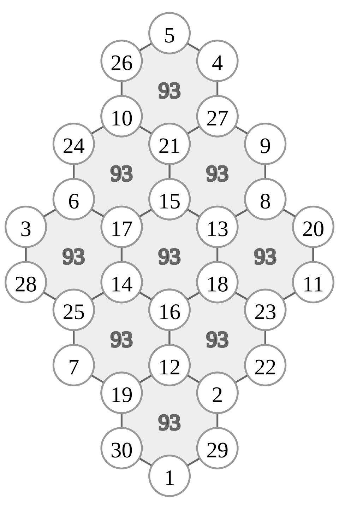

# Jisu-guimundo: overview

The Jisu-guimundo (地數龜文圖, "earthly-number tortoise-pattern diagram") places the numbers 1, 2, 3, … on the vertices of a honeycomb so that the six vertices of every hexagon have the same sum. The Gusuryak gives a Jisu-guimundo with nine hexagons and thirty vertices.

The figure shows one arrangement on this nine-hexagon, thirty-vertex structure in which every hexagon sums to 93. When the hexagon sums are added up, some vertices are counted once, some twice and some three times, so different arrangements can give different hexagon sums.[^construction]

## Source text and basic numbers

The Gusuryak text describes a tortoise-shell Jisu-guimundo of nine hexagons (九宮), with the invariant that every hexagon sums to 93 and a scheme for subdividing the space.

| Source | Translation | Mathematical meaning |
| --- | --- | --- |
| 六子各得九十三數 | Each six numbers obtain 93. | the six vertices of each hexagon sum to *S* = 93 |
| 九宮共得八百三十七數 | The nine palaces together obtain 837. | 9 × 93 = 837 |
| 中眷三宮, 三宮爲主則 | The three middle palaces form the central axis. | the three central hexagons govern the whole |
| 左右十二子 分爲二宮 | The twelve numbers on the left and right are divided into two palaces. | grouping of the twelve vertices on the two sides |
| 四正爲四宮, 中間六子合爲一宮 | The four cardinal directions form four palaces, and the six middle numbers form one palace. | four outer palaces plus the central vertices |
| 凡九宮化爲十二宮 | In all, the nine palaces become twelve palaces. | the nine hexagons regrouped into twelve units |

## Numbers made (作) and places used (用)

* **Numbers made (三十子作)**: 1 to 30, each once; *T* = 1 + 2 + … + 30 = 465.
* **Places used (五十四子用)**: nine hexagons of six places, 54 in all.
* **Shared places**: 54 − 30 = 24. Of the thirty vertices, 14 belong to one hexagon, 8 to two and 8 to three.

With *S* = 93, the total *T* and the weighted overlap *D* of the shared vertices satisfy

    9 × S = T + D,   9 × 93 = 465 + D,   D = 372

## Congruences and spatial symmetry

The phrase 九宮化爲十二宮 can be read as a regrouping of the space by residue systems built on 2 and 3, combined with 5 (the five phases).

* **mod 2 (parity and left–right symmetry)**: since 93 is odd, each hexagon contains an odd number (1, 3 or 5) of odd numbers; the most balanced case is three odd and three even. 左右十二子 分爲二宮 gives the rule for dividing the parity of the twelve side vertices evenly.
* **mod 3 and mod 9**: the three central regions (中眷三宮) correspond to the residue classes mod 3, and the 3 × 3 extension appears as the layout of the nine hexagons.
* **mod 4 and mod 12**: the four directions (四正爲四宮) combine with the mod-3 axis to give 3 × 4 = 12 sub-units.
* **Chinese remainder theorem**: combining the coprime systems mod 3 (axes), mod 4 (directions) and mod 5 (phases) fixes a position uniquely with period lcm(3, 4, 5) = 60.

The full source interpretation and mod analysis are in [README.md](README.md).

[^construction]: A simple construction: colour the top vertex blue and adjacent vertices alternately yellow, and write 1 at the top. Fill the blue vertices going down to the lower left by steps of 1 (2, 3, 4); start the next line at 5, the lower right of the hexagon containing 1, and fill 6–8; fill 9–12 and 13–15 in the same way. For the yellow vertices, write 16 at the bottom and go up ↗ with 17–19; start again at 20, upper left of 16, with 21–23, and fill 24–27 and 28–30 in the same way. Blue vertices then increase by 1 towards the lower left and by 4 towards the lower right from hexagon to hexagon, and yellow vertices decrease by the same amounts, so every hexagon has the same sum. That sum differs from the Gusuryak's 93. The method also works for a square array of hexagons, and starting at the top yellow vertex or filling alternately upwards and downwards gives further arrangements.
