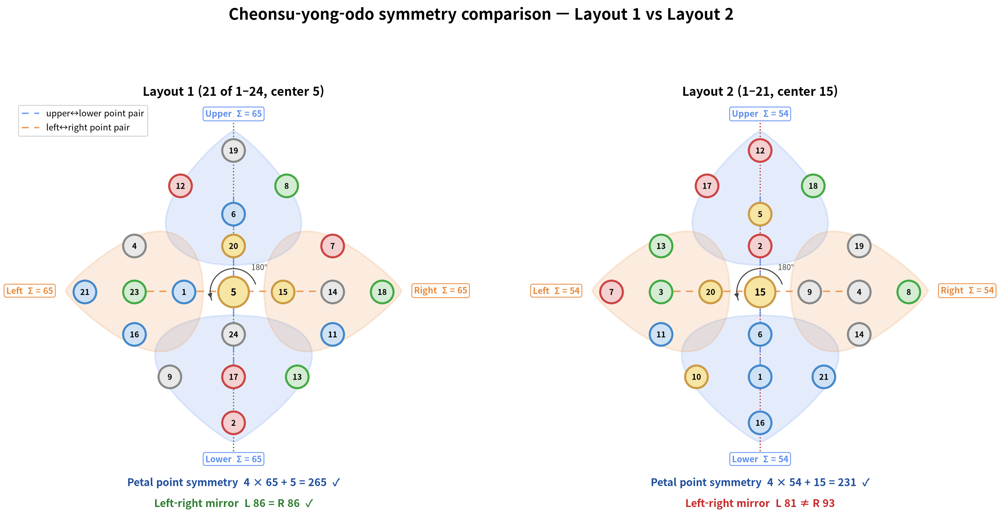

# Ojagakdeuk (Five-Each-Gets / Diagram Using Five Heavenly Numbers) — Modern Combinatorial and Positional Analysis Report

> A modern mathematical reinterpretation of the Ojagakdeuk (五子各得) diagram, also known as Cheonsu-yong-odo (天數用五圖), from the *Gusuryak* (九數略) family of diagrams.
> **Analysis target**: A diagram placing 21 of the numbers 1 through 24 in the Cheonsu-yong-odo form.
> **Analysis premise**: The original diagram contains only points (nodes) and no connecting lines, so this report considers only positional, wuxing (five-phase), and combinatorial invariants.
> **Clarification**: This report and its associated visualization figures represent a **Rule Variation Model** constructed for mathematical study, rather than a raw historical facsimile of the original manuscript.

---

## 1. Basic Structure and Verification

### 1.1 Data Summary

Ojagakdeuk places 21 of the natural numbers 1–24 in a specific geometric form. The numbers 3, 10, and 22 are omitted; the remaining 21 numbers are divided into five wuxing (phase) groups by mod 5.

| Item | Content |
|:---:|:---|
| Numbers used | 1, 2, 4, 5, 6, 7, 8, 9, 11, 12, 13, 14, 15, 16, 17, 18, 19, 20, 21, 23, 24 (21 total) |
| Omitted numbers | 3, 10, 22 |
| Total sum | 265 |
| Number of wuxing groups | 5 |

- **Verification**: The sum of 1 through 24 is 300, and subtracting the omitted 3 + 10 + 22 = 35 gives **265**.

### 1.2 Cheonsu-yong-odo Form

The 21 nodes form a Cheonsu-yong-odo geometry converging from the upper vertex (19) to the lower vertex (2). A central vertical axis 19-6-20-5-24-17-2 runs through the middle, and the widest horizontal band lies near y = 2.0.

```
                 19
           12          8
                 6
     4           20          7
21   23    1     5    15    14   18
     16          24          11
           9     17    13
                 2
```

> Observation 1: The upper 19 and lower 2 are the two extremes of the Cheonsu-yong-odo; the vertical axis (19-6-20-5-24-17-2) and the central horizontal band (21-23-1-5-15-14-18) cross at the central 5.

---

## 2. Geometric Structure Analysis

### 2.1 Topological Features

The original text mentions no edges or specific relationships between points, and no meaningful relationship graph could be extracted, so the structure is analyzed from the placement of points alone.

- **Number of nodes**: 21
- **Upper vertex**: 19 (y = 6.0)
- **Lower vertex**: 2 (y = -1.7)
- **Vertical central axis**: 19 → 6 → 20 → 5 → 24 → 17 → 2 (7 nodes, sum 93)
- **Central horizontal band**: 7 nodes (1, 5, 14, 15, 18, 21, 23) at y = 2.0

> Observation 2: The central 5 is the only point where the vertical axis meets the widest horizontal band (y = 2.0); the 1 and 15 on either side of it form the inner wings of that band.

### 2.2 Vertical Layer Distribution

| Layer | Position | Nodes | Sum |
|:---:|:---|:---|:---:|
| Upper vertex | y = 6.0 | 19 | 19 |
| Upper connector | y = 5.0–4.2 | 8, 12, 6 | 26 |
| Central horizontal band | y = 3.3–2.0 | 4, 7, 20, 1, 5, 14, 15, 18, 21, 23 | 128 |
| Lower connector | y = 0.8–-0.4 | 11, 16, 24, 9, 13, 17 | 90 |
| Lower vertex | y = -1.7 | 2 | 2 |

> Observation 3: The central horizontal band accounts for 128, nearly half of the total sum, showing that the center of the Cheonsu-yong-odo is mathematically the heaviest part.

---

## 3. Wuxing (Five Phases) mod 5 Analysis

### 3.1 Phase Classification and Sums

| Wuxing | mod 5 | Numbers | Sum | Count |
|:---:|:---:|:---|:---:|:---:|
| Water (水) | 1 | 1, 6, 11, 16, 21 | 55 | 5 |
| Fire (火) | 2 | 2, 7, 12, 17 | 38 | 4 |
| Wood (木) | 3 | 8, 13, 18, 23 | 62 | 4 |
| Metal (金) | 4 | 4, 9, 14, 19, 24 | 70 | 5 |
| Earth (土) | 5 | 5, 15, 20 | 40 | 3 |

> Observation 4: Splitting the 21 numbers into five wuxing groups gives Water (5), Metal (5), Fire (4), Wood (4), and Earth (3). Restoring the omitted 3 (Wood), 10 (Earth), and 22 (Fire) within 1–24 makes Water, Fire, Wood, and Metal have 5 numbers each, while Earth has 4. Extending to 25 completes a full 5 × 5 structure.

### 3.2 Spatial Distribution of Wuxing

| Wuxing | Main positional feature |
|:---:|:---|
| Water | Left (1, 16, 21), center (6), and right (11) |
| Fire | Lower vertex (2) and central axis (17), plus one each on the left (12) and right (7) |
| Wood | Three on the right (8, 13, 18), one on the left (23) |
| Metal | Evenly distributed across left, right, and center (4, 9, 14, 19, 24) |
| Earth | On the vertical axis (5, 20) and immediately right of the center 5 (15) |

> Observation 5: Of the Earth numbers, 5 and 20 lie on the vertical axis and 15 lies on the horizontal band just right of the center 5. All three cluster around the center 5, so Earth forms the core of the structure.

---

## 4. Position-Based Analysis

### 4.1 Sum by Horizontal Level (y-coordinate)

| y-coordinate | Nodes | Sum |
|:---:|:---|:---:|
| 6.0 | 19 | 19 |
| 5.0 | 8, 12 | 20 |
| 4.2 | 6 | 6 |
| 3.3 | 4, 7, 20 | 31 |
| 2.0 | 1, 5, 14, 15, 18, 21, 23 | 97 |
| 0.8 | 11, 16, 24 | 51 |
| -0.4 | 9, 13, 17 | 39 |
| -1.7 | 2 | 2 |

> Observation 6: The y = 2.0 level contains 7 nodes with sum 97, forming the widest central horizontal band of the Cheonsu-yong-odo. This is about 36.6% of the total sum 265.

### 4.2 Left-Center-Right Symmetry

| Region | Nodes | Sum |
|:---:|:---|:---:|
| Left (x < -0.5) | 1, 4, 9, 12, 16, 21, 23 | 86 |
| Center (-0.5 ≤ x ≤ 0.5) | 2, 5, 6, 17, 19, 20, 24 | 93 |
| Right (x > 0.5) | 7, 8, 11, 13, 14, 15, 18 | 86 |

> Observation 7: **The left and right regions have exactly the same sum, 86**. This is a strong positional invariant showing that the Cheonsu-yong-odo has a harmonious left-right symmetric structure.

### 4.3 mod 5 Residue Spatial Pattern

Viewing the coordinates as x-columns / y-rows, the mod 5 residues are not random. In particular, along the vertical central axis (y = 6.0 → -1.7) the sequence 19 (Metal) → 6 (Water) → 20 (Earth) → 5 (Earth) → 24 (Metal) → 17 (Fire) → 2 (Fire) shows a continuous change of wuxing along the central axis.

### 4.4 Cross-Palace (Petal) Structure — Center 5, Each Palace Sums to 65

Applying exactly the same slot partition as Layout 2 (`analysis_report_2.md` §5) to Layout 1, the four palaces (petals) around the center 5 each contain five numbers and all sum to 65.

| Palace | Numbers | Sum |
|:---:|:---|:---:|
| Upper | 19, 12, 8, 6, 20 | 65 |
| Left | 21, 4, 16, 23, 1 | 65 |
| Right | 18, 7, 11, 14, 15 | 65 |
| Lower | 2, 9, 13, 17, 24 | 65 |
| Center | 5 | 5 |

- **Verification**: 4 × 65 + 5 = 265.
- Because the four partial sums are equal, opposite palaces (upper↔lower, left↔right) match under point reflection through the center 5, and the pattern of partial sums is unchanged by a 90° rotation.
- Layout 1 has this petal structure **together with** left-right mirror balance (86 = 86, §4.2). Layout 2 keeps only the petal structure and loses the mirror balance, but in exchange its palace sum is 54 (= 6 × 9) and its outer total 216 (the Qian tally, 乾之策), exactly the numbers in the source text. The two layouts are compared in `10_symmetry_comparison.png`.



---

## 5. Study on Rule Variation and System Extension

### 5.1 1–24 Rule Variation Model Study

The original 21-number diagram is a self-contained diagram that fully satisfies left-right symmetry (left sum = right sum = 86) and vertical axis alignment. Analyzing the addition of unselected numbers (3, 10, 22) is not a correction of errors, but rather a study on rule variation exploring mathematical properties when extending the number system under the same geometric framework.

| Wuxing | Original Selected | Variation Added | 24-Number Variation Group | Sum | Count |
|:---:|:---|:---:|:---|:---:|:---:|
| Water | 1, 6, 11, 16, 21 | — | 1, 6, 11, 16, 21 | 55 | 5 |
| Fire | 2, 7, 12, 17 | 22 | 2, 7, 12, 17, 22 | 60 | 5 |
| Wood | 8, 13, 18, 23 | 3 | 3, 8, 13, 18, 23 | 65 | 5 |
| Metal | 4, 9, 14, 19, 24 | — | 4, 9, 14, 19, 24 | 70 | 5 |
| Earth | 5, 15, 20 | 10 | 5, 10, 15, 20 | 50 | 4 |

> Observation 8: Under the 24-number variation rule, Water, Fire, Wood, and Metal groups each contain 5 numbers, whose sums form an **arithmetic progression (55, 60, 65, 70) increasing by 5**.

### 5.2 Full 5 × 5 Extension Model Study

Extending the system to the 1–25 range and adding 25 to the Earth group yields a full 5 × 5 = 25-number extension model.

| Wuxing | Complete Extension Group | Sum |
|:---:|:---|:---:|
| Water | 1, 6, 11, 16, 21 | 55 |
| Fire | 2, 7, 12, 17, 22 | 60 |
| Wood | 3, 8, 13, 18, 23 | 65 |
| Metal | 4, 9, 14, 19, 24 | 70 |
| Earth | 5, 10, 15, 20, 25 | 75 |

The total sum of the complete 5 × 5 extension model is 55 + 60 + 65 + 70 + 75 = **325**. The original layout sum of 265 corresponds to this complete extension sum minus the unselected variation numbers (3 + 10 + 22 = 35). Rather than correcting the original, this offers an perspective on structural extensibility.

---

## 6. Conclusion

Ojagakdeuk (Cheonsu-yong-odo) is not merely a placement of 21 numbers; it has the following multi-layered structure.

### Summary of Key Findings

1. **21-number geometric placement**: 21 numbers from 1–24 excluding 3, 10, and 22.
2. **Cheonsu-yong-odo form**: A geometric structure converging from the upper vertex (19) to the lower vertex (2).
3. **Vertical central axis**: 19-6-20-5-24-17-2 (sum 93).
4. **Central horizontal band**: 7 nodes at y = 2.0 with sum 97.
5. **Left-right symmetric sum = 86**: The strongest positional invariant.
6. **Weight of the central horizontal band**: The y = 3.3–2.0 interval has the maximum sum, 128.
7. **Wuxing sums**: Water 55, Fire 38, Wood 62, Metal 70, Earth 40.
8. **Earth concentrated at the center**: 5 and 20 lie on the vertical axis; 15 sits immediately right of the center 5.
9. **Arithmetic progression on full 25-number extension**: 55, 60, 65, 70, 75 (common difference 5).
10. **Petal (cross-palace) structure**: the four palaces around the center 5 all sum to 65 (4 × 65 + 5 = 265); opposite palaces are point-symmetric.
11. **No edges in the original**: This analysis is based solely on position, wuxing, and combinatorial invariants.

---

## 7. Generated Visualizations

Running `analyze_ojagakdeuk.py` produces the following 8 images:

- `01_original_graph.png` — Original Cheonsu-yong-odo placement (wuxing colors, no edges)
- `02_wuxing_decomposition.png` — Wuxing subgroup decomposition
- `03_spatial_distribution.png` — mod 5 residue spatial distribution and phase coordinates
- `04_symmetry_analysis.png` — Left-center-right symmetry and sums by horizontal level
- `05_invariants.png` — Wuxing sums, left-center-right sums, level sums, and 5 × 5 extension counts
- `06_wuxing_relations.png` — Wuxing mutual-generation and mutual-overcoming relation diagram
- `07_rule_variation_model.png` — Complete 5 × 5 extension plus vertical layer sum distribution
- `08_position_patterns.png` — Sums by horizontal level and left-center-right symmetry
