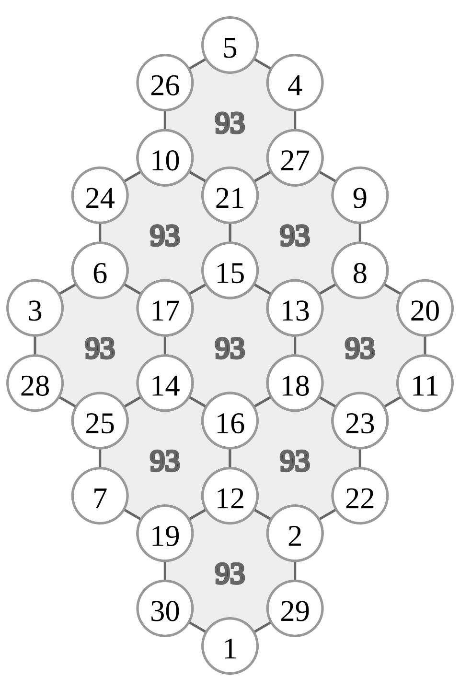

# 지수귀문도 개요

지수귀문도(地數龜文圖)는 벌집 모양으로 배열된 꼭짓점에 1부터 차례로 수를 놓아, 각 육각형의 여섯 꼭짓점의 합이 모두 같게 만든 마법진이다. 구수략에는 육각형 9개, 꼭짓점 30개인 지수귀문도가 실려 있다.

위 그림은 9개 육각형·30개 꼭짓점 구조에서 각 육각형의 합이 93이 되는 배치의 예다. 육각형의 꼭짓점 합을 셀 때 한 번만 더해지는 꼭짓점, 두 번 더해지는 꼭짓점, 세 번 더해지는 꼭짓점이 섞여 있어서, 배치에 따라 육각형의 합이 달라질 수 있다.[^풀이법]

## 원문과 기본 수치

구수략의 원문은 9개의 육각형(九宮)으로 이루어진 거북등 형태의 지수귀문도를 설명하며, 각 육각형의 부분합이 93이 되는 불변량과 공간 분할 체계를 다룬다.

| 원문 | 해석 | 수리적 의미 |
| --- | --- | --- |
| 六子各得九十三數 | 6개 수의 합이 93이다. | 각 육각형의 6개 꼭짓점 수의 합 *S* = 93 |
| 九宮共得八百三十七數 | 9개 궁의 총합은 837이다. | 9개 육각형 부분합의 총계 9 × 93 = 837 |
| 中眷三宮, 三宮爲主則 | 중앙의 3개 궁이 중심축을 이룬다. | 중앙 3개 육각형이 전체 구조를 주도 |
| 左右十二子 分爲二宮 | 좌우 12개 수가 2개 궁으로 나뉜다. | 좌우에 놓인 12개 꼭짓점의 그룹 분할 |
| 四正爲四宮, 中間六子合爲一宮 | 사방의 4개 궁과 중앙 6수를 1개 궁으로 합친다. | 동서남북 4개 외곽 궁과 중앙 꼭짓점들의 결합 |
| 凡九宮化爲十二宮 | 무릇 9개 궁이 12개 궁으로 바뀐다. | 9개 육각형 구조를 다시 나누어 12개 단위로 재구성 |

## 作(작)과 用(용)의 분리

꼭짓점에 실제로 적히는 고유한 수의 개수인 작(作)과, 기하학적 자리의 총수인 용(用)이 구분된다.

* **고유 수(三十子作)**: 1부터 30까지의 정수가 꼭짓점에 한 번씩 들어간다. *T* = 1 + 2 + … + 30 = 465.
* **총 자리 수(五十四子用)**: 육각형 9개에 자리가 6개씩이므로 구조상 54자리가 쓰인다.
* **중복 자리 수**: 인접한 육각형끼리 꼭짓점을 공유하여 생기는 잉여 자리는 54 − 30 = 24개다. 꼭짓점 30개 가운데 14개는 한 육각형에, 8개는 두 육각형에, 8개는 세 육각형에 속한다.

부분합 *S* = 93을 넣으면 고유 수의 합 *T*와 공유 꼭짓점에 의한 중복 합 *D* 사이에 다음이 성립한다.

    9 × S = T + D,   9 × 93 = 465 + D,   D = 372

## 합동식 체계와 공간 대칭

원문의 「九宮化爲十二宮」은 2와 3을 바탕으로 한 잉여류 체계에 5(오행)를 결합하여 공간을 다시 나누는 과정으로 정리할 수 있다.

* **mod 2 (홀짝과 좌우 대칭)**: 육각형의 합 93이 홀수이므로 6개 수 가운데 홀수의 개수는 홀수(1, 3, 5개)여야 한다. 가장 균형 잡힌 경우는 홀수 3개와 짝수 3개다. 「左右十二子 分爲二宮」은 좌우에 놓인 12개 꼭짓점의 홀짝 분포를 고르게 나누는 기준이 된다.
* **mod 3과 mod 9 (삼궁과 구궁)**: 중심축을 이루는 세 영역(「中眷三宮」)은 mod 3의 잉여류에 대응하고, 이를 확장한 3 × 3 격자가 9개 육각형의 배치로 나타난다.
* **mod 4와 mod 12 (사정과 십이궁)**: 사방(「四正爲四宮」)의 mod 4 구조가 mod 3 축과 결합하여 3 × 4 = 12개 하위 단위로 나뉜다.
* **중국인의 나머지 정리**: 서로소인 mod 3(공간 축), mod 4(사방), mod 5(오행)를 결합하면 lcm(3, 4, 5) = 60을 주기로 좌표가 하나로 정해진다.

자세한 원문 해석과 mod 분석은 [README.md](README.md)에 있다.

[^풀이법]: 가장 쉽게 만드는 방법은 다음과 같다. 맨 위 꼭짓점을 파란색, 인접한 꼭짓점을 노란색으로 번갈아 칠하고, 맨 위에 1을 쓴다. 파란색 꼭짓점은 왼쪽 아래로 내려가며 1씩(2, 3, 4), 다음 줄은 1과 같은 육각형의 오른쪽 아래 5에서 시작해 6~8, 같은 방식으로 9~12, 13~15를 채운다. 노란색 꼭짓점은 맨 아래에 16을 쓰고 ↗ 방향으로 17~19, 16의 왼쪽 위 20에서 21~23, 같은 방식으로 24~27, 28~30을 채운다. 그러면 파란색 꼭짓점은 육각형이 왼쪽 아래·오른쪽 아래로 갈 때 1씩·4씩 커지고, 노란색 꼭짓점은 1씩·4씩 작아지므로 모든 육각형의 합이 같아진다. 이 배치의 육각형 합은 구수략의 93과 다르다. 이 방법은 육각형이 정사각 배열일 때도 통하며, 시작점을 맨 위의 노란색 점으로 하거나 채우는 순서를 위/아래로 번갈아 바꾸면 다른 배치도 얻는다.
